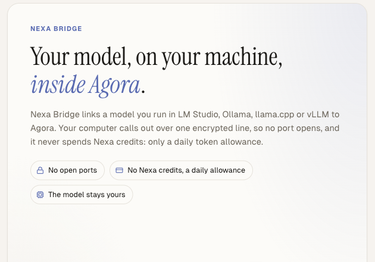
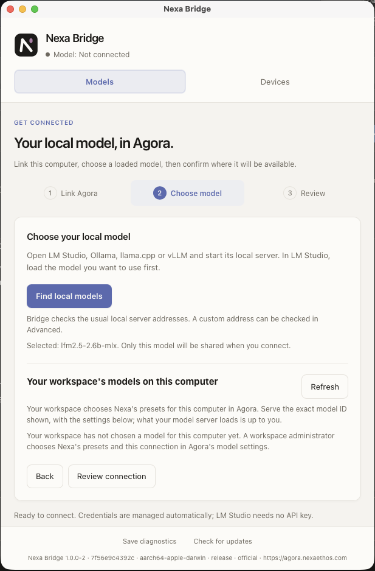
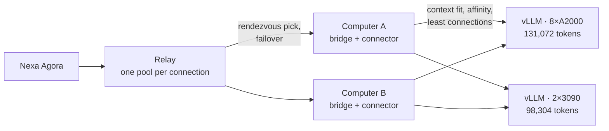
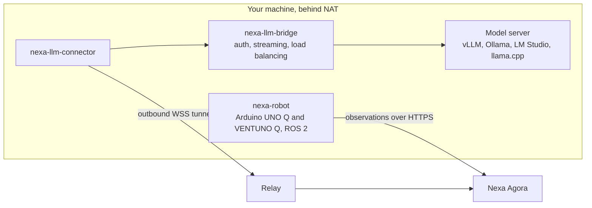

<p align="center">
  
</p>

<h1 align="center">Nexa Bridge</h1>

<p align="center">
  <b>Your own models, and your machines, inside Nexa Agora — from behind NAT, with no port to open.</b>
</p>

<p align="center">
  <a href="https://agora.nexaethos.com">Nexa Agora</a> ·
  <a href="#on-your-computer-the-desktop-app">Desktop app</a> ·
  <a href="#on-a-linux-server-one-command">Server CLI</a> ·
  <a href="#high-availability-and-load-balancing">High availability &amp; load balancing</a> ·
  <a href="#quickstart">Quickstart</a> ·
  <a href="docs/wiki/README.md">Documentation</a> ·
  <a href="docs/wiki/robot.md">Robotics</a>
</p>

<p align="center">
  <a href="https://github.com/NexaEthos/nexa-bridge/actions/workflows/ci.yml"></a>
  <a href="#licence"></a>
  
  
  <a href="https://discord.gg/k2cFcM2Kc"></a>
</p>

<p align="center">
  
</p>

A small, fast **Rust** workspace that puts an OpenAI-compatible proxy in front of your local model server (vLLM,
Ollama, LM Studio, llama.cpp) and holds an outbound tunnel to the cloud. [Nexa Agora](https://agora.nexaethos.com),
or any platform that speaks the OpenAI API, then uses your box like any other endpoint, which is what makes a
genuinely sovereign, EU-resident model path possible.

## On your computer: the desktop app

<p align="center">
  
</p>

For a laptop or a workstation, on macOS, Windows and Linux. Link the computer to your Nexa Agora workspace with an
approval in your browser, choose a model your local server has loaded (LM Studio, Ollama, llama.cpp or vLLM), review
where it will be available, and connect. The app keeps its credential in the operating system's keychain and runs the
bridge and the connector for you: no API key to manage. Download it from the
[latest release](https://github.com/NexaEthos/nexa-bridge/releases/latest).

## On a Linux server: one command

For a GPU server you reach over SSH. The installer checks both programs against the release's checksums, finds
your model server (vLLM, SGLang, Ollama, LM Studio, llama.cpp), links the server to your Nexa Agora workspace through
an approval in your browser (a link, a code and a QR code in the terminal), lets you choose the model, and starts the
bridge and the connector as systemd user services:

```sh
curl -fsSL https://raw.githubusercontent.com/NexaEthos/nexa-bridge/main/install.sh | sh
```

```sh
nexa-bridge status             # the link, the services, the model and whether it answers
nexa-bridge model <exact id>   # serve another model id and restart the services
nexa-bridge unlink             # stop the services and remove this server's credentials
```

Running the installer again updates the programs and restarts the services. To remove everything:

```sh
curl -fsSL https://raw.githubusercontent.com/NexaEthos/nexa-bridge/main/install.sh | sh -s -- --uninstall
# or, with the programs installed:  nexa-bridge uninstall
```

The device then stays approved in Agora until you revoke it in Settings › Bridge. Every option, file and secret:
[docs/wiki/server-setup.md](docs/wiki/server-setup.md).

## High availability and load balancing

A model served through Nexa Bridge stays up when a machine goes down, and spreads its load across every GPU you give
it. Two layers do it, and they compose:

- **Failover across computers.** Link a second computer to the same connection and the relay serves the model
  from both: each conversation keeps to one computer through rendezvous hashing on `X-Affinity-Key`, a computer whose
  tunnel has dropped is skipped as the request is sent and the next one in the order takes it, and a computer that
  stops beating leaves the pool before a request finds it dead. Removing one never reshuffles the others.
- **Load balancing across model servers.** One bridge balances its model across several model servers serving the
  same exact id, on that machine and on others in your network, of any size.



On the server that runs the bridge, start each model server with the same served name (vLLM:
`--served-model-name`), then add them to the pool:

```sh
nexa-bridge pool add http://192.168.1.21:8000 --key "$VLLM_API_KEY"   # --key when that server asks for one
nexa-bridge pool add http://192.168.1.22:8000 --max-inflight 16       # its concurrency, e.g. vLLM --max-num-seqs
nexa-bridge pool remove http://192.168.1.22:8000
nexa-bridge pool                                                       # every member, its answer and its load
```

```text
pool        «google/gemma-4-31b-qat» on 2 model server(s), balanced by this bridge
  http://127.0.0.1:8000  this server · answering · 3/16 in flight
  http://192.168.1.21:8000  key set · answering · 1/16 in flight
```

Each request goes to the member that fits it: a server whose context cannot hold the request is skipped, a
conversation stays on one server so its prefix cache stays warm, the idlest server takes the rest, and a server that
stops answering is set aside by a circuit breaker until it recovers — never dropped from the failover chain. A model
server that does not answer when you add it still joins, and gets work once it answers.

Nexa Agora shows the same picture on its Nexa Bridge page: how many computers serve the connection and how many are
online, how many model servers stand behind them and how many are healthy, and whether the connection fails over and
balances. How the bridge decides: [docs/wiki/load-balancing.md](docs/wiki/load-balancing.md).

## What it does

- **Your own models, no port open.** The bridge binds loopback and the connector dials out; nothing listens on a
  public address, and the model stays on your machine.
- **Many machines, one model.** A multi-GPU server, a workstation and a Mac can serve the same model behind one
  endpoint, with context fit, conversation affinity and failover.
- **A desktop app.** A tray app pairs the computer from the browser, keeps its credential in the OS keystore and
  supervises the bridge and the connector.
- **One command on a server.** Over SSH, on the box that runs the model:

  ```sh
  curl -fsSL https://raw.githubusercontent.com/NexaEthos/nexa-bridge/main/install.sh | sh
  ```

  It installs the programs after checking their checksums, prints a link, a code and a QR code a workspace
  administrator approves from any device, lets you choose the model, prints its serving flags and starts both
  programs as services. See [server setup](docs/wiki/server-setup.md).
- **Physical endpoints (preview).** `nexa-robot` pairs an Arduino Q board — UNO Q or VENTUNO Q — or a ROS 2 robot
  with a workspace on its own credential and sends observations over HTTPS. Observation only: the device takes no
  commands.

## Profiles

Agora sends your model's requests with an operating profile the workspace chooses for the connection, named by model
family and never by a checkpoint: **Qwen**, **Qwen High**, **Qwen Extra High**, **Gemma**, **Muse Glimmer** and
**LFM**. The three Qwen profiles differ by one number only, the reasoning budget — 512, 1,024 or 2,048 tokens per
call — because on Qwen 3.x the level word alone does not bound the reasoning: measured, without a budget 14 of 15
planning runs spent the whole output window thinking; with one, every run closed and answered. What each profile
sends and what your runtime must support: [docs/wiki/profiles.md](docs/wiki/profiles.md).

Want a profile that is not there yet? Propose it in the **Bridge** section of the
[NexaEthos Agora Discord](https://discord.gg/k2cFcM2Kc).

## How it works



## Where it is going: Physical AI

The bridge is how Nexa Agora reaches beyond the screen. We are developing it to connect Agora's orchestration — its
agents, projects, playbooks and approvals — with the machines a company runs: lab boards, robots, production lines.
It is our bridge to **Physical AI**: agents that understand what the physical world reports and, with a person's
approval, act on it. Advancing in that world is one of our priorities. Today `nexa-robot` observes; every step beyond
observation will come with explicit grants and human approval, and the emergency stop stays physical and local.

⭐ **Star this repository to follow the Physical AI work.**

> **Status: pre-1.0.** The proxy, authentication, health checks, multi-device load balancing, `/_node/*`
> observability and the desktop tray app are implemented. Signed installers and the cross-platform acceptance matrix
> remain release gates. The read-only Arduino Q and ROS 2 battery adapters are implemented and accepted end to end
> against a Nexa Agora workspace on the UNO Q; the VENTUNO Q, read on the same adb path, is in acceptance.
> A continuous ROS/Zenoh transport remains open.

## Quickstart

**1. Run the bridge in front of your model server:**

```sh
cp crates/bridge/config.example.toml config.toml     # edit upstream_url + api_key
cargo run --release -p nexa-llm-bridge

# or config-free — env wins over the file:
export BRIDGE_UPSTREAM_URL=http://127.0.0.1:8000
export BRIDGE_LISTEN_ADDR=127.0.0.1:8088
export BRIDGE_API_KEY="$(openssl rand -hex 32)"
cargo run --release --locked -p nexa-llm-bridge
```

`upstream_url` is **scheme + host only, no `/v1`** — the bridge forwards the full request path.

**2. Smoke-test it:** use a second terminal with `BRIDGE_API_KEY` set to the same key configured
for the running bridge. The examples above use port 8088; a configuration-free invocation without
`BRIDGE_LISTEN_ADDR` uses port 8080.

```sh
curl localhost:8088/healthz                                  # → ok
curl localhost:8088/readyz                                   # → ready (probes your model server)
curl localhost:8088/v1/models -H "Authorization: Bearer $BRIDGE_API_KEY"
curl localhost:8088/v1/chat/completions -H "Authorization: Bearer $BRIDGE_API_KEY" \
  -H 'content-type: application/json' \
  -d '{"model":"<your-model>","messages":[{"role":"user","content":"hello"}],"stream":true}'
```

**3. Make it reachable from the cloud.** Two options:

- **The tunnel** — run `nexa-llm-connector` alongside the bridge. It dials **out** over WSS to a
  relay endpoint and holds the tunnel open. Nothing listens on a public address anywhere on your
  box. See [docs/wiki/connector.md](docs/wiki/connector.md).
- **A private overlay** — join the box to a WireGuard/Tailscale network and point the platform at
  its overlay address. See [docs/wiki/auth-and-security.md](docs/wiki/auth-and-security.md) for the
  `allow_unauthenticated` opt-in that case implies.

**4. Point your platform at it** — provider `openai`, `base_url` = the bridge's address plus `/v1`,
`api_key` = your `BRIDGE_API_KEY`, `model` = the served model name. No platform-side code change:
it is just another OpenAI-compatible endpoint.

## Why it exists

Cloud platforms address models by URL. A GPU box behind NAT has no URL. Everything here follows from
closing that gap without asking anyone to open a port:

- **The box only ever dials out.** The bridge binds loopback; the connector originates the tunnel.
- **The tunnel is not the security boundary.** The bridge always enforces its own bearer key, hashed
  at rest and compared in constant time, so a compromised path cannot reach your raw model server.
- **Streams pass through byte for byte.** No SSE re-parsing, no buffering — time-to-first-token and
  backpressure survive the extra hop.

## Multiple devices, one model

Several `[[upstreams]]` entries serving the same model name form a pool — on a linked server,
[`nexa-bridge pool add`](#high-availability-and-load-balancing) writes them for you. That is how one model scales across
heterogeneous hardware — a multi-GPU server, a workstation, a Mac — behind one endpoint:

- **Context fit** excludes a device that cannot hold the request.
- **`X-Affinity-Key`** pins a conversation to one device via rendezvous hashing, so consecutive
  rounds hit a warm prefix cache instead of re-prefilling.
- **Least connections** balances everything else.
- **Saturation escape** and a **circuit breaker** demote a device that is over its concurrency budget
  or wedged — always demoted, never excluded, so the failover chain stays intact.

Full details in [docs/wiki/load-balancing.md](docs/wiki/load-balancing.md).

## Crates

| crate | binary | role |
| --- | --- | --- |
| `protocol` | — | The tunnel wire contract. Public and stable. |
| `build-info` | — | Build-script helper: the build block (version, commit, target, profile, declared channel) every binary carries. |
| `bridge` | `nexa-llm-bridge` | The reverse proxy: auth, streaming, load balancing, `/_node/*`. |
| `connector` | `nexa-llm-connector` | Dials out, holds the tunnel, forwards to the bridge. |
| `robot` | `nexa-robot` | Read-only Arduino UNO Q and VENTUNO Q (USB, adb) and local ROS 2 battery observations; separate hardware pairing and HTTPS delivery on Unix. See [robot.md](docs/wiki/robot.md) for tested scope. |
| `desktop` | `nexa-desktop` | Tauri 2 tray app: browser pairing, OS-keystore credentials, model selection, supervised bridge + connector sidecars. |

## Documentation

Everything lives in **[docs/wiki/](docs/wiki/README.md)** — architecture, configuration reference,
the proxy internals, load balancing, the security model, deployment, and the contributor guide.
Code comments are one line by design; the reasoning is in the wiki.

## Build

```sh
cargo build --release --locked --workspace --exclude nexa-desktop
./crates/desktop/sync-sidecars.sh     # stage the sidecars, then build the desktop app
cargo build --release --locked -p nexa-desktop
```

Rust 2024 edition, rust-version 1.96, `#![forbid(unsafe_code)]` in every crate. The box release
target is `x86_64-unknown-linux-musl` — a fully static binary; desktop builds are platform-native
and, on Linux, need the WebKitGTK and AppIndicator development packages listed in
[docs/wiki/desktop.md](docs/wiki/desktop.md#building-it). The gate CI runs — and the one to run
before a push — is in [docs/wiki/development.md](docs/wiki/development.md#the-ci-gate). See
[docs/wiki/deployment.md](docs/wiki/deployment.md) for the box.

## Official builds and the name

Builds published by NexaEthos are signed, and the name **Nexa Bridge**, the artwork in `brand/` and
the identifier `ai.nexaethos.bridge.desktop` identify them. Forking and building your own is what
the licence is for: give a modified build its own name and identifier, so nobody mistakes it for an
official release when something needs troubleshooting.

Every release file carries a GitHub provenance attestation and a line in `SHA256SUMS`; verify one with
`gh attestation verify <file> --repo NexaEthos/nexa-bridge`. How a release is built, verified, signed
and published is in [docs/wiki/release.md](docs/wiki/release.md).

## Questions and ideas

Ask in [Discussions](https://github.com/NexaEthos/nexa-bridge/discussions): **Q&A** for how to connect a model server
or a machine, **Ideas** for what the bridge should do next, **Show and tell** for what you run with it. Issues are for
bugs.

## Security

Report vulnerabilities privately — see [SECURITY.md](SECURITY.md).

## Contributing

Welcome — see [CONTRIBUTING.md](CONTRIBUTING.md). Hardware contributions must include real-device
acceptance and an agreed capability contract; the current adapters are described in [robot.md](docs/wiki/robot.md).

## Licence

Licensed under either of

- Apache License, Version 2.0 ([LICENSE-APACHE](LICENSE-APACHE) or
  <http://www.apache.org/licenses/LICENSE-2.0>)
- MIT licence ([LICENSE-MIT](LICENSE-MIT) or <http://opensource.org/licenses/MIT>)

at your option.

Unless you state otherwise, any contribution you intentionally submit for inclusion in this work, as
defined in the Apache-2.0 licence, shall be dual licensed as above, without any additional terms or
conditions.
